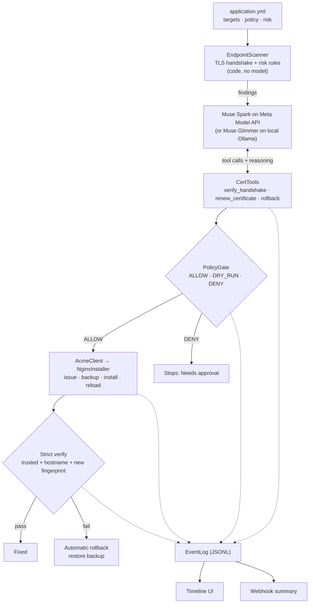
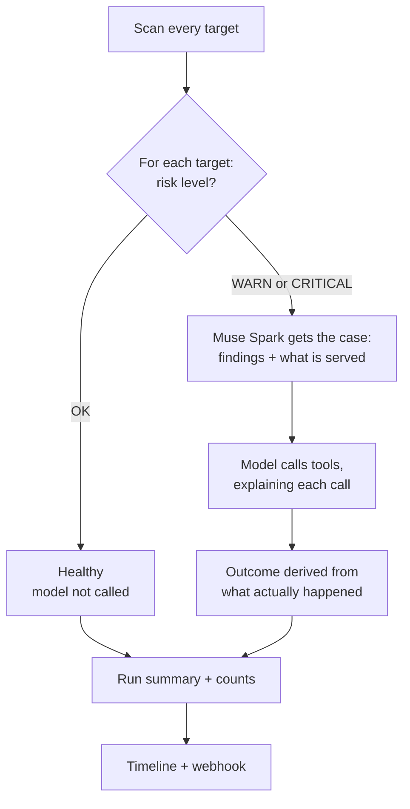
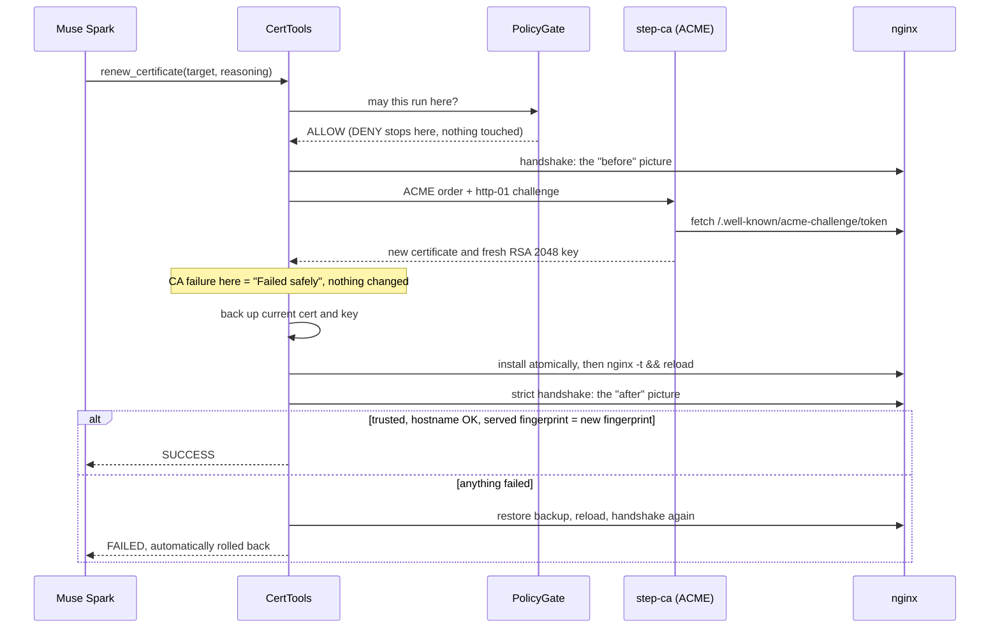

# CLAUDE-VIDEO.md — CertAgent presentation and video brief

Source material for anyone (person or agent) building the slides, diagrams or demo video. It covers the idea, the
architecture, the workflows, the technology, and a visualisation plan.

Facts here were checked against the code on branch `muse-spark` (commit `ddd2738`) and the timeline of the real runs
on 2026-11-02. Timings and quotes are real unless marked otherwise. Before writing a claim on a slide, read
[§9 Claims to get right](#9-claims-to-get-right).

Hackathon: Meta Global AI Developer Hackathon (Cerebral Valley), Indie Developer track, theme *Build for Your World*.
Deadline: **Wed Nov 4, 9:00 PM ET**, target noon. Deliverable here: a **3-minute video** showing only work done during
the event (Oct 26 – Nov 4).

---

## 1. The idea in one screen

> **Monitoring tells you a cert will expire. cert-manager renews certs it owns. CertAgent takes any endpoint, figures
> out what's wrong, fixes it, and proves it — or puts it back.**

**The problem.** Expired and misconfigured TLS certificates still take down production services. The tools split the
job: monitors raise an alert, renewers look after only the certificates they issued. Nobody looks at an arbitrary
endpoint, works out why its certificate is bad, picks a fix, applies it, and proves the result. An on-call engineer
does that by hand, often at 3 a.m.

**The answer.** An autonomous operator with a strict division of labour:

| Who | Job | Why it matters |
|---|---|---|
| **Code** | Finds and classifies the problem | Deterministic. A model can't talk itself out of a finding |
| **Muse Spark** | Reasons over the findings, chooses the fix, explains why | This is the agent: visible judgment, not a script |
| **Policy** | Decides whether that action may run | The operator stays in control, per environment and per tool |
| **Code** | Applies the change, verifies it, rolls back on failure | Safety never depends on the model's choice |

**The line to land:** *the model decides, policy permits, code proves.*

**How it maps to the judging rubric**

| Criterion | Weight | What to show |
|---|---|---|
| Impact | 30% | Real clients failing on a bad cert, recovering after the fix (traffic probe) |
| Use of Meta AI tooling | 25% | Muse Spark's own reasoning as the headline on every case card |
| Technical depth | 20% | x509 checks, ACME, policy gate, fingerprint-proven verification, automatic rollback |
| Demo | 25% | Real run in real time: a whole cycle takes about 25 seconds |

---

## 2. Architecture

### 2.1 System overview



### 2.2 Where things run

This is the picture that makes the safety story and the data boundary clear. Draw it as two zones with one narrow
arrow between them.

```
┌───────────────────── YOUR NETWORK ─────────────────────────┐      ┌── META MODEL API ──┐
│                                                            │      │                    │
│  CertAgent (Java, :8088)                                   │ case │   Muse Spark       │
│   scanner · policy gate · tools · ACME client              │ prompt   muse-spark-1.3   │
│   backups · verification · rollback · timeline         ────┼─────▶│                    │
│                                                        ◀───┼──────│                    │
│  Docker lab                                                │ tool │                    │
│   step-ca (private ACME CA) :9000                          │ calls│                    │
│   nginx: demo.lab :8443 · shop.prod :8444 · accounts.lab :8445    └────────────────────┘
│   Java apps behind nginx: storefront · checkout · accounts │
│   Traffic probe :8090                                      │      Never sent:
│                                                            │      private keys, certificate files
└────────────────────────────────────────────────────────────┘
```

- **Sent to the API:** each case prompt (target name, endpoint, certificate details, findings), the tool results the
  model reads, and the facts for the run summary.
- **Never sent:** private keys and certificate files.
- **Fully on-prem option:** `certagent.model: glimmer` swaps the top-right box for Muse Glimmer on local Ollama, and
  then nothing leaves the network.

### 2.3 Components

| Component | File | What it does |
|---|---|---|
| Scanner + risk rules | `scan/EndpointScanner.java` | Records whatever chain a server presents, even an untrusted one, then judges it in code |
| Trust bundle | `config/TrustConfig.java` | JVM roots + lab root CA, used by the scanner and the ACME client |
| Model selection | `config/ModelConfig.java` | Muse Spark (default) or Glimmer, chosen by one setting |
| Agent loop | `agent/CertAgentRunner.java` | The cycle, the system prompt, outcome derivation; cron, startup and `/api/run` triggers |
| Tools | `tools/CertTools.java` | The only three things the model can do, plus the renew and auto-rollback flow |
| Policy gate | `policy/PolicyGate.java` | ALLOW / DRY_RUN / DENY per environment and tool, plus an action budget per run |
| ACME client | `acme/AcmeClient.java` | Gets a new certificate with an http-01 challenge via a webroot |
| Installer | `exec/NginxInstaller.java` | Backup, atomic install, `nginx -t && reload`, restore |
| Event log | `store/EventLog.java` | Append-only timeline, in memory and in `data/events.jsonl` |
| API | `web/EventsController.java` | `/api/events`, `/api/inventory`, `/api/status`, `POST /api/run` |
| Timeline UI | `static/index.html` | One file, no framework, no external requests |
| Notifier | `agent/Notifier.java` | Slack-compatible webhook summary |

**Rules the code enforces** (good slide material):
1. The model never touches files, sockets or processes. It can only call the three tools.
2. Risk is computed in code. The model reasons over findings; it doesn't produce them.
3. Every tool call passes through the policy gate before anything runs.
4. Every change has a backup first and a strict verify after. Failure means rollback **inside the tool**, not at the
   model's discretion.
5. Every tool call carries a `reasoning` argument, which goes on the timeline.

### 2.4 The demo environment

Kept in a separate repo, [eversamurai/certagent-demo-apps](https://github.com/eversamurai/certagent-demo-apps) (local:
`D:\dev\demo_apps`), so the lab looks like a small company.

| Piece | What it is |
|---|---|
| `storefront`, `checkout`, `accounts` | Small Java 21 HTTP services behind nginx. nginx terminates TLS |
| `traffic-probe` (:8090) | Java HTTPS client calling each site every 2 s with strict checks, trusting only the lab root. Shows OK / WARN / FAIL tiles and a strip of recent checks |
| `reasoning-relay` (:11435) | Feeds the live reasoning panel on the probe page |

The probe is the emotional core of the video: it shows **real clients** failing and recovering, and its fingerprint
matches the one on the CertAgent timeline.

---

## 3. Workflows

### 3.1 One run

Triggered at startup, by the daily cron (06:00), or by `POST /api/run` / the **Run cycle now** button. One run at a
time.



The outcome comes from the event log, **not from what the model says happened**:

| Outcome | Condition | Colour |
|---|---|---|
| **Rolled back** | a rollback event exists | amber |
| **Fixed** | a change was installed and the last verify passed | green |
| **Needs approval** | policy denied a change tool | violet |
| Dry run | policy gave DRY_RUN on a change tool | grey |
| Failed safely | the attempt stopped before anything changed | blue |
| Unresolved | anything else | red |
| Healthy | the scan found nothing wrong | green |

### 3.2 What the scanner detects (code only)

| Finding | Level |
|---|---|
| Connection or handshake failed | CRITICAL |
| Expired, or not yet valid | CRITICAL |
| Expires inside the critical window (lab: 30 min) | CRITICAL |
| Expires inside the renew window (lab: 6 h) | WARN |
| Chain doesn't lead to a trusted root | CRITICAL |
| Hostname not in the certificate's SANs | CRITICAL |
| RSA key under 2048 bits | CRITICAL |
| Forbidden signature algorithm | CRITICAL |
| EC key under 256 bits | WARN |

The windows are in hours because the lab CA issues 24-hour certificates. The built-in defaults are 14 days and 3 days.

### 3.3 Renew with automatic rollback (the core sequence)



The detail worth pointing at: passing the handshake isn't enough. The endpoint must serve **the exact certificate
that was just installed**, matched by SHA-256 fingerprint. That catches a reload that silently didn't take.

### 3.4 Policy decision

```
tool call → over the run's action budget? → DENY
          → environment + tool in config?  → no: DENY (default deny)
          → yes: ALLOW / DRY_RUN / DENY     (dry-run mode turns ALLOW into DRY_RUN)
```

| | `verify_handshake` | `renew_certificate` | `rollback` |
|---|---|---|---|
| **lab** | ALLOW → `AUTO · lab` | ALLOW → `AUTO · lab` | ALLOW |
| **prod** | ALLOW → `AUTO · prod` | DENY → `APPROVAL NEEDED · prod` | DENY |

Policy is ordinary YAML, read by code. **The model can't change it or argue with it.** When denied, the tool tells the
model: *a human must approve this change, do not retry.*

### 3.5 The prompt contract

The model reads each tool result by its first word: `OK`/`SUCCESS` (it worked), `FAIL`/`FAILED` (it didn't, and a
renewal has already restored the old certificate), `DENIED` (don't retry or work around it), `DRY-RUN` (nothing
changed), `ERROR` (something broke). It must verify first, choose the least invasive fix, verify again after a change,
and finish in 2–3 sentences.

---

## 4. Demo scenarios, with real data

Case 1, 2 and 4 data below are from the runs recorded on 2026-11-02 on Muse Spark. Case 3 is different: see the warning
under it.

### Case 1: Untrusted issuer → Fixed (`./lab/break.sh untrusted`)

Real timeline of `run-20261102-233317-ca0a`:

| Time | Step | What happened |
|---|---|---|
| 0.1 s | Diagnose | CRITICAL: chain doesn't validate (issuer `CN=Rogue Corp Root`) |
| 2.0 s | Decide | *"Need to confirm the untrusted issuer finding live before acting, checking issuer, expiry and trust status."* |
| 2.1 s | Verify | Handshake FAIL |
| 3.7 s | Decide | *"Handshake confirms issuer CN=Rogue Corp Root is untrusted with expiry 2026-12-03 and EC 256 key; renewal will replace it with a trusted CA cert for demo.lab."* `AUTO · lab` |
| 6.0 s | Apply | New certificate installed, backup taken |
| 9.3 s | Verify | Handshake OK. Fingerprint `2aa27252044c…` → `1fc0f1672613…` |
| 11.1 s | Prove | *"Renew succeeded with trusted chain; doing final verification to prove demo.lab is now healthy."* |
| 13.0 s | Done | **Fixed** |

**On the probe:** demo.lab goes red ("certificate not trusted"), then green, with the same fingerprint as the timeline.

### Case 2: Production → Needs approval (always present)

`shop.prod` is issued a 4-hour certificate, inside the renew window. Same run:

- 15.1 s: verifies live: handshake OK, expires in 3h52m.
- 16.7 s: *"Live handshake confirms cert from Lab CA Intermediate expires in 3h52m within 6h window … so renewal is the
  least invasive fix"* → **`APPROVAL NEEDED · prod`**.
- 19.4 s: **Needs approval**. Nothing changed. The model reports that human approval is required.

**Key beat:** the same model with the same reasoning gets a different result, because policy is not the model's call.

**On the probe:** shop.prod stays amber, with no outage.

### Case 3: Weak key + broken reload → Rolled back (`./lab/break.sh weak`, then `./lab/break.sh reload`)

`reload` leaves a config snippet that `nginx -t` rejects, like a half-finished change someone left behind.

1. Diagnose: `weak key: RSA 1024 bits (minimum 2048)`.
2. The model renews, and the new certificate is issued and installed.
3. The reload is refused: `nginx: [emerg] invalid parameter "max_fails=three"`.
4. The tool restores the backup by itself. The timeline draws: `old → new (struck through) ↩ backup restored`.
5. The endpoint serves the backed-up fingerprint again, and the site never went down.

Recorded result (Glimmer, `run-20261101-203947-580e`): **Rolled back**, and a client probing every 2 s never saw a
failed request.

> **Warning: this case has not been recorded on Muse Spark yet.** The local timeline has only the three Spark runs from
> Nov 2, none with a rollback. Run it once before the recording session.

**On the probe:** demo.lab stays amber throughout and never red. The renewal failed, and customers never noticed. This
is the most impressive moment in the video.

### Case 4: Wrong hostname → Fixed (`./lab/break.sh hostname`)

`accounts.lab` serves a valid, trusted certificate issued for the old name `legacy-accounts.lab`: the classic "copied
the wrong cert" mistake. From `run-20261102-233546-5726` (21 s for the whole run):

- 6.6 s: CRITICAL: `hostname accounts.lab not in certificate SANs [legacy-accounts.lab]`.
- 10.1 s: *"Live cert is for legacy-accounts.lab with trusted issuer and good EC256 key but SAN lacks accounts.lab, so
  renewal for accounts.lab is the least invasive fix."*
- 14.8 s: handshake OK, fingerprint `c96c7f60792c…` → `2e029bb42282…`.
- 17.7 s: **Fixed**.

Use it only if there's time. It's not in the 90-second plan in `CLAUDE.md` §10. Its value is showing the model working
out a *different* fault with the same tool.

### Measured speed

| Model | Scenario | Whole run |
|---|---|---|
| Muse Spark (API) | Cases 1 + 2, 3 targets | **25 s** |
| Muse Spark (API) | Cases 2 + 4, 3 targets | **21 s** |
| Muse Spark (API) | Case 2 only, 3 targets | **15 s** |
| Muse Glimmer (local, RTX 4070 12 GB, partly on CPU) | Cases 1 + 2, or 3 + 2; 2 targets | 12–21 min |

Runs this short need no speed-up: **the demo can be shown in real time**, which is much more convincing than a
time-lapse.

---

## 5. Technology

| Layer | Technology | Why |
|---|---|---|
| Language / runtime | Java 21 (built with Maven wrapper 3.9.16) | Strong TLS and x509 APIs in the JDK; target audience runs Java |
| Framework | Spring Boot 3.5.16 | Config binding, scheduling, REST API |
| AI integration | Spring AI 1.1.8 | `@Tool` / `@ToolParam`, the tool-calling loop |
| Model (default) | **Muse Spark** `muse-spark-1.3` on **Meta Model API**, `https://api.meta.ai/v1/chat/completions` | Fast tool calling; low reasoning effort for speed |
| Model (on-prem) | **Muse Glimmer** `muse-glimmer:30b`, open weights (27.9B params, Q4_K_M), on Ollama | Distilled from Spark; nothing leaves the network |
| ACME | acme4j 3.5.1 (http-01) | Standard certificate automation protocol |
| Private CA | smallstep step-ca 0.30.2 | Real ACME server in the lab |
| Web server | nginx 1.30 (alpine) | The endpoints being fixed; TLS termination |
| Lab | Docker Compose, bash break scripts | Reproducible faults on demand |
| Demo apps | Java 21, JDK only | Believable services and real strict-TLS clients |
| UI | Vanilla HTML/CSS/JS, single file | No framework, no build step, no external requests |
| Storage | Append-only JSONL | No database; a readable audit trail |
| Tests | JUnit 5, AssertJ, BouncyCastle | Real handshakes against throwaway TLS servers with generated certificates |

**Numbers for a slide:** 3 tools · 27 tests · 15 main Java files · about 1,700 lines of main Java and about 1,070 of
test Java · 1 single-file UI · whole demo run about 25 s.

---

## 6. Visualisation plan

### 6.1 Visual language

Match the timeline UI so slides and footage look like one thing. Dark theme, system fonts, monospace for hostnames and
fingerprints.

| Token | Hex | Meaning |
|---|---|---|
| Background | `#0d1117` | Page |
| Panel | `#151b23` | Cards |
| Line | `#2a3442` | Borders |
| Text / muted | `#e6edf3` / `#8b98a8` | Copy |
| Green | `#3fb950` | Trusted, Fixed, handshake OK |
| Red | `#f85149` | Broken, handshake FAIL |
| Amber | `#d29922` | Warning, Rolled back |
| Violet | `#bc8cff` | Policy stop, Needs approval |
| Blue | `#58a6ff` | The model, its decisions |

**Colour rule that carries the story:** blue = the model thinks, violet = policy decides, green/red = reality.

### 6.2 Recurring motifs

- **The stepper:** Observed → Diagnosed → Decided → Policy → Applied → Verified. It's the app's real UI and the
  backbone of the video. Introduce it once and reuse it as the structure for explanations.
- **The padlock:** red to green is instantly readable by non-experts. Use it in the problem and the payoff.
- **The fingerprint:** a short code like `1fc0f1672613…` highlighted in **both** the timeline and the probe. That single
  match is the "proof" made visible.
- **The reversal arrow:** `old → new ✕ ↩ old`. It's the visual identity of the rollback.
- **The model's words:** show real quotes large. Reasoning text is the product, and it's what judges score.

### 6.3 Diagrams to make

| # | Diagram | How to draw it | Message |
|---|---|---|---|
| 1 | The gap | Three columns: Monitoring (alerts), cert-manager (only its own certs), CertAgent (any endpoint → fix → proof) | Why this exists |
| 2 | Division of labour | Four blocks in a row: Code finds → Model decides → Policy permits → Code proves. Blue only on the model block | Agent with guardrails |
| 3 | Pipeline | §2.1 as a left-to-right flow. Animate one case travelling through it | How it works |
| 4 | Two branches | Same pipeline, forking at Policy (stop) and at Verify (rollback) | Safe by construction |
| 5 | Data boundary | §2.2 two zones with one arrow, list what crosses and "never sent" | Trust |
| 6 | The switch | One toggle: Spark ⇄ Glimmer, everything else unchanged and greyed out | Open weights option |

### 6.4 Storyboard for the 3-minute video

Built backward from `CLAUDE.md` §10. Screen layout for the demo: **timeline left, traffic probe right, small terminal
along the bottom**.

| Time | Picture | Narration idea |
|---|---|---|
| **0:00–0:20** Problem | Red padlock, then headlines or alert noise; diagram 1 | "Certificates still cause outages. Monitors alert. Renewers only touch their own certs. Someone still gets paged at 3 a.m." |
| **0:20–0:30** Setup | The split screen, all healthy and amber | "Three Java services, real clients calling them every two seconds, and one agent." |
| **0:30–0:50** Case 1 break | Terminal `break.sh untrusted`. Probe tile goes **red** | "Someone installs a cert from the wrong CA. Clients start failing." |
| **0:50–1:15** Case 1 fix | Timeline card fills in; zoom on reasoning, `AUTO · lab`, before/after. Probe **green**; highlight the matching fingerprint | "Muse Spark confirms it live, explains itself, renews. And it proves it: the cert clients now see is the one it installed." |
| **1:15–1:30** Case 2 | shop.prod card, zoom on violet `APPROVAL NEEDED · prod` | "Same reasoning, but this is production. Policy says stop, and it stops." |
| **1:30–2:00** Case 3 | `break.sh weak`, `break.sh reload`. Renew attempt, `[emerg]`, reversal arrow. Probe **never turns red** | "Now the hard one. The renewal works, but nginx refuses to reload. It puts the old cert back by itself. Customers never noticed." |
| **2:00–2:30** Architecture | Diagrams 2 and 4 | "The model decides, policy permits, code proves. The model can't touch a file, and rollback is not its choice." |
| **2:30–2:50** Meta tooling | Diagrams 5 and 6, timing numbers | "Muse Spark decides in seconds. The same agent also runs fully local on open-weight Muse Glimmer, and we recorded that too." |
| **2:50–3:00** Close | The one-line pitch, repo URL | "Any endpoint. Figures out what's wrong. Fixes it. Proves it, or puts it back." |

Keep the real timer visible, or say it aloud: a whole run takes about 25 seconds.

### 6.5 Recording notes

- Follow `D:\dev\demo_apps\demo\RUNBOOK.md` and reset with `demo/reset.sh`, **not** `lab/init.sh` alone, which drops
  the nginx overlay. Its "20 minutes per take" timing is for Glimmer; Spark takes seconds.
- Start CertAgent with `--certagent.schedule.run-on-startup=false` so the first run happens on camera.
- `CLAUDE.md` §10: record the agent run once and narrate over it; never re-run live in the video.
- **Never show `config/application.yml` on screen**: it holds the API key. Don't show a terminal where the key was
  exported either.

---

## 7. Likely questions, with answers

| Question | Answer |
|---|---|
| What if the model picks something wrong? | It has three tools. Policy gates each one. Renewal verifies and rolls back regardless of what the model thinks. Outcomes come from the event log, not its words |
| Why use a model at all, rather than a script? | Reasoning over mixed findings, explaining decisions in plain English to on-call engineers, reacting to tool results. The safety parts are deliberately code |
| Does it handle Java keystores or Kubernetes? | Not in this build; it installs PEM files into nginx. JKS/PKCS12 over SSH and Kubernetes secrets are on the roadmap |
| Does it work with public CAs? | It speaks standard ACME. The demo uses a private step-ca; a public CA hasn't been tested |
| What leaves the network? | With Spark: case prompts and tool results. Never keys or cert files. With Glimmer: nothing |
| Can it be run without Meta's API? | Yes. `certagent.model: glimmer`, on Ollama |

---

## 8. Roadmap (for an optional closing line)

Certificate files over SSH (PEM/PKCS12/JKS) · Kubernetes TLS secrets · internal-CA reissue · "add missing intermediate"
fix · pull-request output · Slack approval buttons · multi-tenant/RBAC · Vault/HSM keys · Windows certificate store.

---

## 9. Claims to get right

| Don't say | Say instead | Why |
|---|---|---|
| "Nothing leaves the network" | "Your keys and certificates never leave. Fully on-prem with Glimmer" | The default sends case prompts and tool results to Meta Model API |
| "Runs locally on open weights" (for footage of Spark runs) | "Muse Spark decides here. The same agent also ran fully on Glimmer on Nov 1" | Footage must match the chip on screen |
| "50× faster" | The measured numbers: 15–25 s vs 12–21 min | Different target counts and one specific local GPU; a ratio overclaims |
| "Tracks and fixes Java keystores" | "Java services behind nginx; keystores are on the roadmap" | The agent installs PEM files into nginx only |
| "Production-ready" | "Tested on a lab with a private CA" | No real production or public-CA run yet |
| "Fixes any certificate problem" | "Fixes what a renewal fixes, and stops or rolls back otherwise" | An unreachable endpoint, for example, ends as Unresolved |

Do not use mock data in the video. Every number and quote should come from a real run.

---

## 10. Open items before recording

- [ ] **Run case 3 on Muse Spark** at least once. So far it has only been recorded on Glimmer.
- [ ] **Merge decision:** the demo depends on `muse-spark`, which isn't merged into `main`. Judges will see `main` first.
- [ ] **CLAUDE.md §10** lists three cases; case 4 is documented in the README. Decide whether it's in the video.
- [ ] **Rotate the Meta API key** after the event: it was pasted into a chat session.
- [ ] Check the hackathon rules on licensing. The repo has no license yet.
